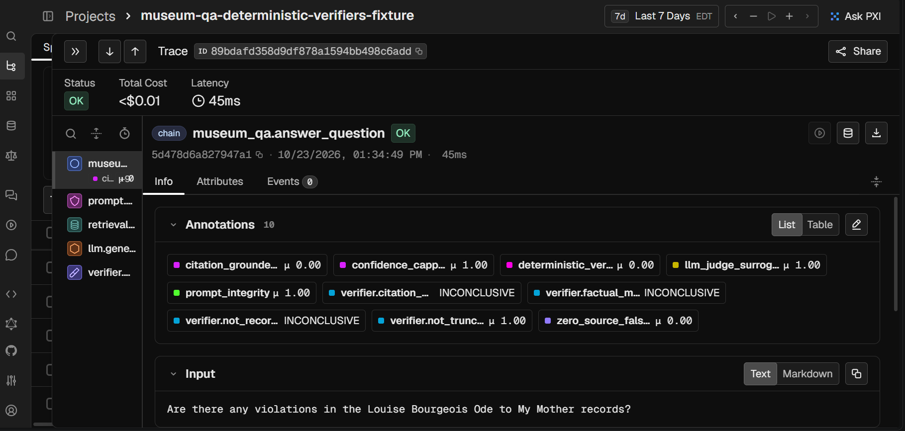
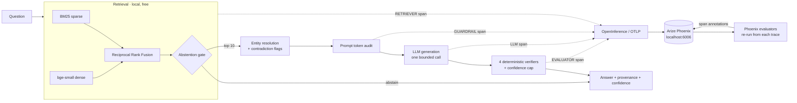
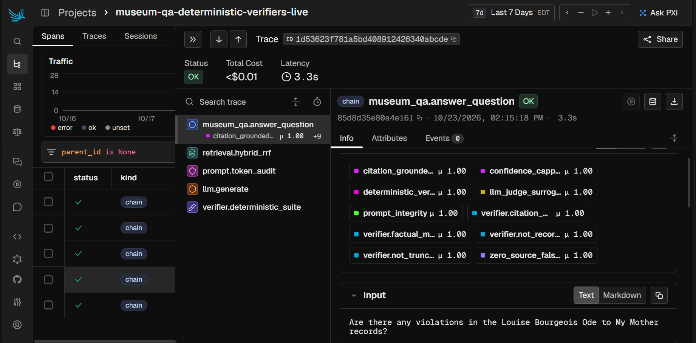
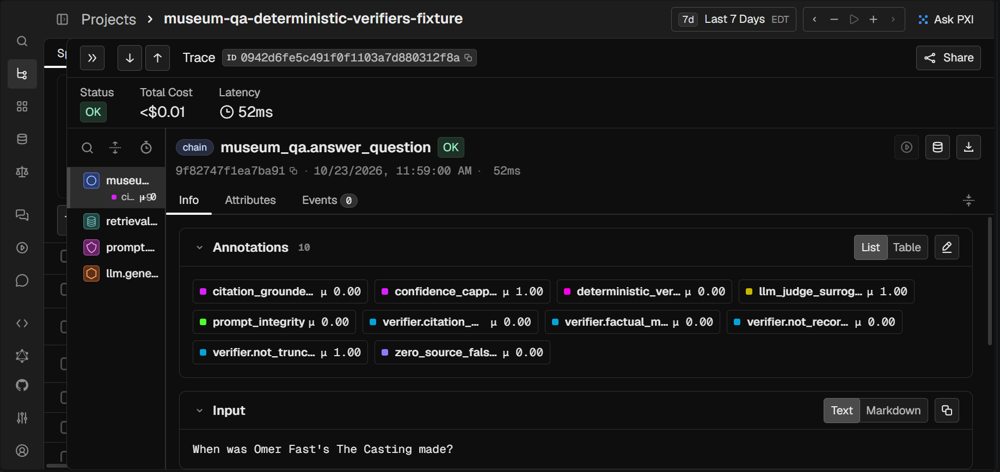

# Catching LLM False Passes with Deterministic Verifiers & Arize Phoenix

[](https://gargi-09.github.io/phoenix-museum-qa-evals/)
[](https://docs.arize.com/phoenix)
[](https://github.com/Arize-ai/openinference)
[](https://github.com/gargi-09/phoenix-museum-qa-evals/actions/workflows/release-gate.yml)

A museum-records QA pipeline (~5,000 records from the Cleveland Museum of Art
and the Art Institute of Chicago) instrumented end to end with OpenInference,
with 8 deterministic evaluators whose results are logged to Phoenix as span
annotations.

**The problem it demonstrates:** a reference-free LLM-as-a-judge sees only the
question and the answer. *"No violations found. The records are consistent and
every field is verified."* is fluent, on-topic and confident, so the judge
passes it. It also cites **zero** source records. The deterministic verifiers
see the citations, the retrieved candidate set and the billed `prompt_tokens`,
so they fail it, and Phoenix shows both verdicts on the same trace.

The baseline judge in this repo is `llm_judge_surrogate`, a rule-based
stand-in that sees what an LLM judge sees (question and answer only). It
passes all 3 seeded false passes. The real LLM judge (`make_live_llm_judge`,
`claude-haiku-5-5`), run once on the same three, **passed 2 of 3**; see
[the recorded LLM-judge run](#the-recorded-llm-judge-run).

**[Try it in the browser →](https://gargi-09.github.io/phoenix-museum-qa-evals/)** No key and no
sign-up. Search the 5,010 records live, then edit real Claude answers and see
which checks you can fool. See [the web app](#the-web-app).



*The zero-sources trap in Phoenix. The baseline judge (`llm_judge_surrogate`, a rule-based stand-in that sees what an LLM judge sees) scores the answer 1.00; the deterministic verifiers score it 0.00.*

## 60-second quickstart

```bash
pip install -r requirements.txt && python demo_phoenix_evals.py
```

Then open **http://localhost:6006**. No network, API key or GPU is needed: the
demo runs in **fixture mode** on 10 real public museum records that ship with
the repo (see [Demo modes](#demo-modes)). The Phoenix app it starts stays up
until you press Ctrl+C.

To run it against the full ~5,000-record public corpus instead:

```bash
python src/main.py fetch && python src/main.py ingest && python demo_phoenix_evals.py --mode corpus
```

| Flag | Effect |
|---|---|
| `--mode corpus` | full public corpus + the real BM25 + bge-small retriever, scripted model, no credentials |
| `--mode live` | full public corpus + a real model, Claude Haiku 5.5 by default (see [Live mode](#live-mode)). Paid, opt-in only |
| `--judge live` | replace the offline judge surrogate with a real LLM judge call per trace |
| `--no-launch` | attach to a Phoenix you started yourself (`phoenix serve`) |
| `--exit` | exit when done instead of keeping Phoenix alive |

## Architecture



```
Retrieval (BM25 + Dense RRF) → LLM Generation → OpenInference Tracing → Phoenix Deterministic Evaluators
```



*A live run on Claude Haiku 5.5: the span tree on the left, and all 10 evaluator verdicts as span annotations.*

### What gets traced

There is no LangChain or LLM SDK in this pipeline: `src/api_client.py` posts to
the endpoint with raw `requests`, so no `openinference-instrumentation-*`
auto-instrumentor has anything to hook. [`src/tracing.py`](src/tracing.py)
emits spans by hand using OpenInference semantic conventions, by wrapping the
pipeline's own seams. `reasoning.py` is not modified, and a run without
`instrument_pipeline()` behaves exactly as before.

| Span | Kind | Key attributes |
|---|---|---|
| `museum_qa.answer_question` | CHAIN | `museum_qa.citations.count`, `museum_qa.confidence.*`, `museum_qa.system_prompt_dropped_suspected`, `museum_qa.eval_payload` |
| `retrieval.hybrid_rrf` | RETRIEVER | `retrieval.documents.N.document.{id,score,content}`, `museum_qa.retrieval.bm25_max`, `…best_dense_similarity`, `…abstain` |
| `prompt.token_audit` | GUARDRAIL | `museum_qa.prompt_tokens_expected`, `…instruction_tokens_expected`, `…context_block_ids` |
| `llm.generate` | LLM | `llm.input_messages`, `llm.output_messages`, `llm.token_count.{prompt,completion,total}`, `museum_qa.prompt_tokens`, `museum_qa.prompt_audit.*` |
| `verifier.deterministic_suite` | EVALUATOR | `museum_qa.citations.{count,valid_count,fabricated_count}`, `museum_qa.check.<name>` |

**Why the prompt token audit exists.** This endpoint was measured silently
discarding a separately supplied system prompt: a bare `"hi"` billed 8
`prompt_tokens`, and `"hi"` plus a ~13-token system prompt *also* billed 8,
with a 200 OK. Nothing errors, so the only evidence is the token count. The
GUARDRAIL span estimates the prompt size with and without the ~450-token
instruction block before the call; the LLM span compares the billed count
against both and sets `museum_qa.prompt_audit.status = dropped_suspected` when
the bill is closer to the no-instructions estimate. It is a heuristic (the
estimates are ~4 chars/token), which is why the field says *suspected*.

## Phoenix evaluators

[`src/phoenix_evals.py`](src/phoenix_evals.py). Each evaluator takes the
payload stored on a root span and returns `(label, score, explanation)`. The
demo pulls root spans back **out of Phoenix**
(`phoenix.client.Client().spans.get_spans_dataframe`), runs the evaluators on
them, and writes the verdicts back with `log_span_annotations`, so they show
up in the Annotations tab of the trace they judge.

| Evaluator | Fails when |
|---|---|
| `zero_source_false_pass` | the output asserts an answer, or an all-clear like "no violations", while citing 0 valid source records |
| `citation_groundedness` | any cited record ID is missing from the BM25 + dense RRF candidate set (score = fraction grounded) |
| `confidence_capping` | a confidence escaped its cap: a score emitted with 0 valid citations or a dropped prompt, or a `high` label despite a failed check |
| `prompt_integrity` | the billed `prompt_tokens` say the instruction block never arrived |
| `verifier.citation_membership`<br>`verifier.not_recorded_violation`<br>`verifier.factual_match`<br>`verifier.not_truncated` | the pipeline's own four checks (`reasoning.check_*`), **re-executed** against the context blocks recorded in the trace |
| `llm_judge_surrogate` / `llm_judge` | baseline, not one of the 8: `llm_judge_surrogate` is a rule-based stand-in that sees what an LLM judge sees (question + answer only); `llm_judge` is the real LLM judge, used only with `--judge live` |

A check that cannot fail does not report a pass. When a response cites
nothing, the per-citation verifiers return `INCONCLUSIVE`, not `PASS`, and
are left out of the pass rate.

### The side-by-side

The demo runs five questions. Run in fixture mode, it prints:

| # | Scenario | Judge (rule-based stand-in) | Deterministic |
|---|---|---|---|
| 1 | Clean answer, 1 valid citation | PASS | PASS |
| 2 | "No violations found", 0 citations | **PASS** | **FAIL**: zero sources, confidence capped to 0.0 |
| 3 | System prompt silently dropped | **PASS** | **FAIL**: `prompt_integrity`, 0 citations |
| 4 | Cites a record outside the candidate set | **PASS** | **FAIL**: `citation_groundedness` 0.5 |
| 5 | Out-of-corpus question | NOT_APPLICABLE (nothing to judge) | NOT_APPLICABLE: abstained before any paid call |

`--mode corpus` gives the same verdicts on rows 1–4. On row 5 the question
gets past the abstention gate on the public corpus (see
[the thresholds note](#a-note-on-the-thresholds)), and the scripted model
declines it. `zero_source_false_pass` correctly reads that as a decline, not
a false pass.

In fixture mode, the project's span-annotation summary in Phoenix shows the gap directly:
`llm_judge_surrogate` averages **1.00**, while `deterministic_verdict` averages
**0.25** (1 of the 4 generated answers passes).



**On a real model.** In a live run on Claude Haiku 5.5, every evaluator scored
1.00 on all 5 questions. Asked "Are there any violations…", Haiku answered
from the records it was shown and cited them, so it never fell into the
zero-sources trap. The verifiers passed it because the answer earned it. The
fixture run is what demonstrates the failure modes; the live run shows that the
verifiers don't produce false alarms on good answers.

### Demo modes

Every mode runs the real pipeline code: context assembly, entity resolution,
contradiction detection, prompt construction, parsing, all four verifiers,
confidence scoring and provenance. The modes differ in the corpus, the dense
retriever and the model:

| Mode | Corpus | Dense retrieval | Model | Needs |
|---|---|---|---|---|
| `fixture` (default) | 10 public records in `src/fixtures/` | TF-IDF | scripted | nothing |
| `corpus` | ~5,000 public records in `data/` | bge-small | scripted | `fetch` + `ingest`, ~4–5 min first embed |
| `live` | ~5,000 public records in `data/` | bge-small | your endpoint | `.env` credentials |

- **The fixture is real data, just small.** It holds the 10 works the demo
  questions are about, fetched from the public APIs and normalized by
  `ingest.py`. Nothing in it was typed by hand. Rebuild it with
  `python src/fetch_public_corpus.py --fixture`.
- **The scripted model** returns one response per question, each built to
  trigger a single failure mode. `prompt_tokens` is computed from the prompt
  the pipeline actually built, and the dropped-prompt case leaves out the
  instruction tokens, the way the original endpoint was measured to. Every
  record a script cites exists in both corpora, except the one fabricated on
  purpose (`aic-99999`), so the same scripts work in `fixture` and `corpus`
  mode.
- **The baseline judge** is `llm_judge_surrogate`, a rule-based stand-in
  that sees what an LLM judge sees, unless you pass `--judge live`. It is
  deterministic and gets exactly a reference-free judge's inputs.
- **In live mode** the model answers for itself, so whether a trap fires
  depends on what it actually says. The evaluators report the result either
  way.

## Data: public museum records

The corpus is built from the two museums' own public collection APIs. No
credentials are needed and there is no private endpoint.

```bash
python src/main.py fetch                 # -> data/base.jsonl + data/SOURCES.json
python src/main.py ingest                # -> data/normalized.jsonl
```

[`src/fetch_public_corpus.py`](src/fetch_public_corpus.py):

- **What it fetches.** 2,500 described artworks from each museum (change this
  with `--per-source N`), plus the 10 seed works the demo questions name,
  which are always fetched by ID. A seed that has been withdrawn is reported,
  not silently dropped.
- **Deterministic sample.** CMA is paged in its default order. AIC uses its
  search API with "has a description" filtered server-side, sorted by id,
  with keyset pagination (`id > last id`). The search API refuses to page
  past 1,000 results, which keyset pagination stays inside.
- **Polite.** It sends the `AIC-User-Agent` header AIC asks for (set
  `PUBLIC_API_CONTACT` to your own contact), keeps under AIC's 60
  requests/minute, and retries 429/5xx with backoff.
- **Cached and resumable.** Every API page is saved to `data/raw/`, so a
  re-run makes 0 network calls. Pass `--refresh` to re-download.
- **Nothing dropped silently.** Skipped records are counted by reason in the
  console and in `data/SOURCES.json`, along with the record counts, the seed
  status and the licences.
- **Output** is `ingest.py`'s `structured` format, so the rest of the pipeline
  is unchanged. CMA publishers and printers are left out of the artist field.
  No images are downloaded; `image_path` is filled only for openly licensed
  images.

A full fetch takes about 25 requests (CMA serves 1,000 per page, AIC 100) and
under a minute.

### Licences and attribution

| Source | API | Licence |
|---|---|---|
| Cleveland Museum of Art | [Open Access API](https://openaccess-api.clevelandart.org/) | metadata CC0 1.0 ([terms](https://www.clevelandart.org/open-access)) |
| Art Institute of Chicago | [Public API](https://api.artic.edu/docs/) | CC0 1.0, **except `description`, which is CC BY 4.0** ([terms](https://www.artic.edu/terms)) |

Artwork descriptions from the Art Institute of Chicago, including those in
`src/fixtures/museum_fixture.jsonl`, are © the Art Institute of Chicago and
licensed under [CC BY 4.0](https://creativecommons.org/licenses/by/4.0/). A
CMA record's `share_license_status` describes the rights to its *image*, not
its metadata.

### A note on the thresholds

The abstention thresholds in `src/retrieval.py` (BM25 19.5, dense 0.35) and
the numbers in its comments were measured on the corpus snapshot the pipeline
was first built against. That snapshot came from the same two museums, but it
was a different sample. On the public corpus:

| Question | Best BM25 | Best dense | Gate | Top-1 record |
|---|---|---|---|---|
| Coney Island Beach, Reginald Marsh | 50.93 | 0.767 | passes | `cma-117571` ✓ |
| Louise Bourgeois, Ode to My Mother | 43.62 | 0.714 | passes | `cma-160794` ✓ |
| Omer Fast, The Casting | 26.99 | 0.776 | passes | `cma-168184` ✓ |
| Jeff Brouws, Railroad Landscape #33 | 60.54 | 0.754 | passes | `cma-169223` ✓ |
| Melting point of gallium arsenide | **19.75** | 0.560 | **passes** (just over 19.5) | an unrelated glass work |
| Capital of Mongolia | 17.22 | 0.561 | abstains | n/a |

Retrieval puts the right record first for every in-corpus question. The
gallium-arsenide question, which abstained on the old snapshot at 18.50, now
clears the floor by 0.25, so in `corpus` mode it reaches the model and is
declined there instead of being stopped before the call. This is the overlap
`retrieval.py` already documents: no absolute BM25 cutoff separates the two
classes. The threshold has deliberately not been retuned on six samples.

Re-check them on your own fetch with:

```bash
python src/retrieval.py data/normalized.jsonl "your question" "an off-topic question"
```

`src/demo/transcript.md` is likewise a record of a run on that earlier
snapshot. Some of its record IDs, such as `aic-215406` and `aic-13026`, are no
longer published by AIC.

## Live API (Cloud Run)

**https://museum-qa-api-o7gdkkg7ja-uc.a.run.app**, the backend the
[web app](#the-web-app) calls.

The model outputs are **recorded**: 11 real `claude-haiku-5-5` calls made
once, locally, by [`record_samples.py`](record_samples.py) (54,954 tokens).
The **evaluators run live** on every request. The deployed service never
calls a model: it runs with `LLM_PROVIDER=disabled`, has no API key and no
HTTP client in its image, and generates no answer to a free-text question.

```
GitHub Pages (web/) --POST /evaluate--> Cloud Run: FastAPI + src/rescore.py
  recorded answer (or the visitor's edit) -> parse, truncation check, 4 verifiers,
  confidence cap, prompt-token audit -> 8 evaluators + verdict, computed per request
GitHub Pages (web/) --POST /retrieve--> live BM25 over 5,010 records + the BM25 gate
```

| Endpoint | What it does |
|---|---|
| `GET /health` | status, sample count, `"model_calls": "disabled"` |
| `GET /samples` | the 14 fixed samples (11 recorded questions, 3 seeded failures) |
| `GET /samples/{id}` | one sample: question, retrieved records, recorded answer |
| `POST /evaluate` | `{"sample_id", "answer"?, "system_prompt_delivered"?}` → all evaluator verdicts |
| `POST /retrieve` | `{"question"}` (1–300 characters) → live BM25 top 10 over all 5,010 records, plus the BM25 gate decision. No answer is generated |

```bash
curl -s -X POST https://museum-qa-api-o7gdkkg7ja-uc.a.run.app/evaluate -H "Content-Type: application/json" -d '{"sample_id": "s01"}'
```

**Retrieval: replayed for the samples, BM25-only live for free text.**
- **The 14 samples:** each carries the candidates the real hybrid retriever
  returned when it was recorded. `/evaluate` re-scores against those
  recorded candidates.
- **Free text:** `POST /retrieve`
  ([`server/live_retrieval.py`](server/live_retrieval.py)) runs the BM25 half
  of the retriever and its abstention floor live over the full corpus.
- **Not run live:** the dense half (bge-small) and RRF fusion. They need the
  embedding model, which the image doesn't ship, so live rankings can differ
  from the pipeline's.
- **BM25 scores are the pipeline's own:** the corpus is exported by
  [`scripts/export_corpus.py`](scripts/export_corpus.py) with byte-identical
  passages. A test checks the recorded gate values: q11 is 17.22, q10 is
  19.75.
- **The question itself** is never sent to a model, stored or logged.

**Prompt size.** About 4.4K prompt tokens per call on the recorded runs
(mean 4,395, range 3,694 to 4,900; the 3,694 is s02, sent without its
instruction block). Fixture mode builds smaller prompts.

**What the recorded outputs showed.** The verifiers catch all 3 seeded
failures, which the baseline judge (`llm_judge_surrogate`, the rule-based
stand-in) passes. s01 and s03 are labelled edits of real answers; s02 is a
real call:

- **s01:** q01's real answer with its citations stripped, a zero-source
  false pass.
- **s02:** a real call with the system prompt left out. It came back as
  prose with no citations, and the prompt-token audit flagged the missing
  instruction block.
- **s03:** q04's real answer plus a record ID that was never retrieved.

#### The recorded LLM-judge run

[`scripts/record_llm_judge.py`](scripts/record_llm_judge.py) ran the real
reference-free judge once, locally, on s01–s03. The verdicts, reasons, exact
prompts and raw replies are in
[`samples/recorded_llm_judge.json`](samples/recorded_llm_judge.json)
(3 calls, 1,493 tokens).

| Sample | Real LLM judge | Rule-based stand-in | Deterministic |
|---|---|---|---|
| s01 zero-source | **PASS** | PASS | FAIL |
| s02 dropped system prompt | FAIL | PASS | FAIL |
| s03 ungrounded citation | **PASS** | PASS | FAIL |

What its reasons show:

- **s01:** the answer text still names `cma-117571` in its prose; only the
  structured citation list is empty. The judge read that as a citation. The
  deterministic check requires structured citations, so it fails.
- **s02:** the judge failed it, but **for a reason the record contradicts**.
  It said "four-channel video installation" was likely wrong, while the
  retrieved record (`cma-168184`) lists exactly that medium. It did not
  mention the missing citations or the dropped instruction block, which it
  cannot see.
- **s03:** the judge cannot see that `aic-13026` was never retrieved, so it
  passed.

So the real judge approved 2 of the 3 seeded false passes, not all 3. Its one
rejection came from its own background knowledge, which in this case
disagreed with the museum record.

One real answer, q06, is a **verifier false positive**. Haiku answered
correctly and quoted the accession number "1947.39", which
`verifier.factual_match` read as a year and flagged against the record's
1932. It is left as recorded rather than tuned away.

**Measured latency.** All runs below were taken from one laptop in the US
with [`scripts/measure_latency.py`](scripts/measure_latency.py), on
2026-10-27.

The current service (revision `00003`, with `/retrieve` and the corpus):

| Endpoint | First request | Warm, n=20 | Server compute |
|---|---|---|---|
| `POST /evaluate` | **6,832 ms**, cold | p50 256 ms, p90 614 ms, max 738 ms | 0.31 ms |
| `POST /retrieve` | 312 ms, already warm | p50 362 ms, p90 438 ms, max 451 ms | 34 ms |

The cold start is a real one: it came after 20 minutes idle, and Cloud
Run's log shows a new instance starting.

The first revision (`00001`, before `/retrieve`) measured:

| Endpoint | Cold start | Warm, n=20 | Server compute |
|---|---|---|---|
| `POST /evaluate` | 4,287 ms | p50 110 ms, p90 132 ms, max 133 ms | about 0.3 ms |

What the numbers mean:

- **Network dominates.** The server's own compute is 0.3 ms for the
  evaluators and 34 ms for a BM25 search over 5,010 records, so nearly all
  of each round trip is network and container startup.
- **The warm numbers differ between runs** of the same code path (110 ms
  against 256 ms p50). This is one client on a home connection, so treat
  them as a range, not a benchmark.
- **The longer cold start** is consistent with the new revision building the
  BM25 index at startup, which took 751 ms locally. I haven't isolated it on
  Cloud Run.
- **The image** is 74.2 MB compressed, up from 73.0 MB with the corpus.

**Safety limits:**
- CORS allows only `https://gargi-09.github.io` and localhost.
- Each IP is limited to 30 requests a minute; past that it gets a 429.
- Request bodies are capped at 16 KB and answers at 8,000 characters.
- Request bodies are never logged.
- Cloud Run settings: at most 2 instances, scales to zero, 60 s timeout,
  512 MiB.
- The rate limit is counted per instance, so with 2 instances the ceiling is
  up to 60 requests a minute per IP.
- It runs as `museum-qa-api-runtime`, a dedicated service account with **no
  IAM roles** and no user-managed keys, not the project's default compute
  account, which has Editor on the project. The service calls no Google API.
- If the API is down or slow, the dashboard falls back to the in-browser
  sandbox.

**Deploy your own:**
1. Set a **GCP budget alert** first: Billing → Budgets & alerts, e.g. $5.
2. Record the samples with `python record_samples.py --yes`.
3. Preview the billable and IAM commands with `bash deploy.sh`, then run
   them with `bash deploy.sh --yes`. They create the no-role service account
   if it's missing.

---

## Harness, release gate and metrics

### Harness

[`harness/`](harness/) runs the pipeline's own steps around a typed loop:
retrieve → answer → verify → accept, retry or abstain → trace. It has a
timeout per step and a bounded retry budget with backoff.

- **The gate:** an answer is accepted only when `deterministic_verdict`, the
  roll-up of all 8 evaluators, is PASS. No LLM judge is involved.
- **Abstentions:** every one carries its reason: `retrieval_gate`,
  `retrieval_failed`, `no_further_recorded_attempt` or
  `retry_budget_exhausted`.
- **The pipeline itself is unchanged:** `reasoning.answer_question` still
  makes one model call per answer.

```bash
python -m harness
```

**The public demo shows accepted or abstained outcomes only.** Each sample
has one recorded answer, so in replay a failed check abstains (no further
recorded attempt) instead of retrying. The retry path (retry then accept,
retry then abstain, timeouts, malformed output) is covered by scripted tests
in [`tests/test_harness.py`](tests/test_harness.py).

### Release gate (CI)

[`.github/workflows/release-gate.yml`](.github/workflows/release-gate.yml)
runs on every push to `main` and every pull request, with no secrets and
`LLM_PROVIDER=disabled`. It does four things:

1. checks that no model SDK, HTTP client or torch is installed;
2. checks that the committed `docs/sandbox.js` is the build of
   `docs/src/sandbox.ts`;
3. runs the test suite;
4. runs [`scripts/release_gate.py`](scripts/release_gate.py), with the
   thresholds in [`samples/release_gate.json`](samples/release_gate.json).

The gate blocks a release if:

- any seeded false pass (s01–s03) gets a PASS verdict or is accepted;
- fewer than **6 of the 7** known-good recorded answers (q01–q07) pass. q06
  stays in the count and stays failing: it's the year check's known false
  positive;
- the identity regression goes undetected: s02, sent without its system
  prompt, must fail `prompt_integrity`, and its control q03 must pass it.

The fixture set gets the same seeded and identity checks, plus 1/1
known-good. A separate code-level test checks that the instruction block is
sent to the model in every message format.

```bash
python scripts/release_gate.py
```

### Measured results

[`scripts/run_metrics.py`](scripts/run_metrics.py) writes
[`docs/data/metrics.json`](docs/data/metrics.json). The committed run used
50 timed runs per sample, on one laptop.

| | Result |
|---|---|
| Harness outcomes (14 samples) | 9 accepted, 5 abstained (4 no further recorded attempt: q06, s01–s03; 1 retrieval gate: q11), 0 retried |
| `deterministic_verdict` | 9 PASS, 4 FAIL, plus q11 (abstained) |
| Harness run latency, **measured** | p50 1.263 ms, p95 1.962 ms over 700 runs |
| Recorded tokens per answer (11 calls) | mean 4,995.8 total; prompt mean 4,394.6, range 3,694–4,900 |

- **What the latency covers:** retrieval replay, the evaluators and the
  harness loop only. There is no model call and no network.
- **The first run:** it includes importing the pipeline modules (243.9 ms),
  so it's reported separately.
- **Concurrent vs sequential:** the harness runs the 8 evaluators
  concurrently for isolation, not speed. Its verify step (p50 1.225 ms) is
  slower than the same evaluators run in sequence (p50 0.247 ms).
- **Tokens:** recorded when each answer was made, not measured here.

The design, failure modes and limits are in
[`docs/DESIGN.md`](docs/DESIGN.md).

### Tests

```bash
pip install -r requirements-ci.txt
```
```bash
python -m pytest
```

There are 80 tests. They include:

- a guard that runs the server with tripwires on key reads, client imports,
  outbound sockets and imports of the recorder scripts. It exercises every
  endpoint, including `/retrieve`, and checks each request reached its
  handler rather than a 429;
- live BM25 scores matching the recorded pipeline (q11 17.22, q10 19.75);
- the web app's pinned dependencies and its strict, `any`-free TypeScript;
- the 1,040/1,040 parity test;
- the harness and gate tests.

`requirements-ci.txt` is the dev set plus scikit-learn for the fixture
retriever. It has no torch and no model SDK.

### Limitations

- **A small fixed set:** 14 samples. Two of the three seeded failures (s01,
  s03) are labelled edits of real answers, and the real LLM judge was run
  once, on those three.
- **Not a live answering system:** the deployed service replays recorded
  answers, never calls a model, and answers no free-text question. Live
  search over free text is BM25 only: no dense retrieval, no fusion.
- **One known false positive:** q06 is a correct answer that the year check
  fails. It's documented, not tuned away.
- **Latency comes from one client and one laptop**, and it varies run to
  run. There's no load test and no shared rate limit across instances.

---

## The web app

**[gargi-09.github.io/phoenix-museum-qa-evals](https://gargi-09.github.io/phoenix-museum-qa-evals/)**,
built for people who want to *use* the project, not read it.
[`web/`](web/) is React 18 and strict TypeScript (`noImplicitAny`,
`noUncheckedIndexedAccess`, no `any`), built with Vite and deployed by
[`.github/workflows/pages.yml`](.github/workflows/pages.yml). It's a walk
through three steps:

1. **Search 5,010 museum records (live).** Any question goes through
   `POST /retrieve`: the live BM25 ranking, plus the abstention gate drawn
   against its 19.5 floor. A question that matches a recorded sample links
   to Claude's recorded answer.
2. **Try to fool the verifier.** Edit any of the 14 recorded answers, or
   apply a one-click trick (remove the citations, cite a fake record, wrong
   year, "no violations", plain prose, drop the system prompt).
   - Verdicts: the judge and the verifier are shown side by side, with the
     harness decision and all 8 checks.
   - Scoring: by the Python evaluators on the API. If the API is
     unreachable, by the parity-checked TypeScript engine in the browser,
     and the page says which.
3. **See the measured results.** Read from the committed files: the real
   LLM judge's verdicts, the CI gate, latency and recorded tokens.

Every number on the page comes from a generated file or the API, and each
step is labelled live, partly live or recorded.

```bash
npm ci --prefix web
```
```bash
npm run --prefix web dev
```

`web/scripts/sync-data.mjs` copies the engine and data files into place.
Set `VITE_API_BASE=http://127.0.0.1:8080` in `web/.env.development.local` to
use a local API.

The previous single-file dashboard, [`docs/index.html`](docs/index.html),
stays available as the *technical console* at `/classic.html`. It has the
scenario studio, the span waterfall with token telemetry, and the sandbox
panel.

### Evaluator sandbox: the engine behind step 2

The editor runs the evaluators against the recorded records:

1. Pick one of the 14 recorded samples. They're scored by the
   [live API](#live-api-cloud-run) when it's reachable, and in the browser
   otherwise.
2. Edit what the model said: strip citations, cite a record that was never
   retrieved, claim "no violations", state a wrong year, answer in prose, or
   untick "system prompt delivered".
3. The pipeline re-scores it as you type, with the judge surrogate next to
   the deterministic verifier and all eight evaluators listed.

There is no model call and no API key, so it's safe on a public page.

- **Engine.** [`docs/src/sandbox.ts`](docs/src/sandbox.ts), strict
  TypeScript, compiled with `npm run build:sandbox` to the committed
  [`docs/sandbox.js`](docs/sandbox.js), which Pages serves. It's a
  line-by-line port of everything after the model call: parsing, truncation detection, the four
  `reasoning.check_*` verifiers, confidence scoring, the prompt-token audit,
  and every evaluator in `phoenix_evals.py`.
- **Data.** [`docs/data/sandbox.json`](docs/data/sandbox.json) holds the
  payloads recorded on real fixture-mode traces: question, RRF candidate set,
  context blocks and raw output. Retrieval is fixed to those records;
  everything after the model call re-runs. Rebuild it with:
  ```bash
  python src/export_sandbox_data.py
  ```
- **Parity is checked, not claimed.** On load, the page re-scores every
  exported run and compares each verdict with the Python run's. It shows the
  result ("50/50 verdicts match"). From the CLI:
  ```bash
  node docs/sandbox.js docs/data/sandbox.json
  ```
  A wider test of 104 edited answers, run through both the Python pipeline
  and the JS port, matched on all 1,040 verdicts. Reproduce it (needs
  Node.js and the full `requirements.txt` environment) with:
  ```bash
  python -m pytest tests/test_sandbox_parity.py -v
  ```

Building it surfaced two real issues, both now fixed in the Python code:

- The fixture's scripted model skipped truncation detection, which
  `call_haiku()` normally runs, so a scripted answer cut off mid-JSON scored
  `not_truncated` PASS.
- `deterministic_verdict` only rolled up the four headline evaluators, so an
  answer with the wrong year (`verifier.factual_match` FAIL) still showed an
  overall PASS. The verdict now fails if any deterministic evaluator fails.

Screenshots from a real run go in [`docs/assets/`](docs/assets/README.md),
which lists each filename and what it should show. The dashboard picks them up
automatically: a "From a real run" gallery, plus a Phoenix trace image inside
each scenario. Any image that isn't there yet is hidden rather than shown
broken.

To deploy it, open the repo's **Settings → Pages**, choose **Deploy from a
branch**, then `main` / `/docs`.

---

## The underlying pipeline

Retrieval narrows 5,000 records to 10 using free local compute (BM25 +
`bge-small-en-v1.5`, fused by Reciprocal Rank Fusion). Each question makes
exactly one paid model call. Each answer returns the records it used, the
records it saw and didn't use, four deterministic verification checks, and a
computed confidence score.

- **Demo transcript:** [`src/demo/transcript.md`](src/demo/transcript.md), 10
  questions run end to end on an earlier corpus snapshot (see
  [the note above](#a-note-on-the-thresholds)).

### Setup

```bash
python -m venv venv
venv\Scripts\activate          # or: source venv/bin/activate
pip install -r requirements.txt
python src/main.py fetch       # public museum APIs -> data/base.jsonl
python src/main.py ingest      # -> data/normalized.jsonl (offline, free)
```

`data/` is gitignored, so each clone builds its own corpus. Retrieval needs
no credentials:

```bash
python src/retrieval.py data/normalized.jsonl "What year was Coney Island Beach made?"
```

### Live mode

Live mode makes real model calls, so it needs credentials of your own. It
never runs unless you ask for it: the default `auto` mode stays offline even
when a key is present.

**Anthropic API (recommended).** Put your key in `.env` in the repo root.
`.env` is gitignored, so it is never committed:

```
ANTHROPIC_API_KEY=sk-ant-...
```

Then run:

```bash
python demo_phoenix_evals.py --mode live
```

- **Model.** `claude-haiku-5-5` by default (Claude Haiku 5.5, the cheapest
  current model). Change it with `ANTHROPIC_MODEL`.
- **Cost.** A demo run is 5 calls of roughly 3,500 input and a few hundred
  output tokens each, which comes to well under a cent at Haiku 5.5's rates.
  `--judge live` adds 5 short judge calls. The demo prints the total tokens it
  spent. Setting a spend limit in the Anthropic Console is a sensible cap.
- **What's different on this path** (all of it is in `_call_anthropic()` in
  [`src/api_client.py`](src/api_client.py)):
  - It uses the official `anthropic` SDK.
  - The system prompt goes in the real `system` field.
  - No `temperature` is sent; Haiku 5.5 rejects sampling parameters.
  - Thinking runs at `low` effort (`ANTHROPIC_EFFORT`), with headroom so it
    can't crowd out the JSON answer.
  - A safety refusal is reported as an error, not parsed as an answer.
- **Prompt-token audit.** On this path the audit uses the free `count_tokens`
  endpoint for exact expected counts instead of the ~4 chars/token estimate.

**The original proxy.** The pipeline was first built against a hosted proxy
that speaks a small HTTP contract:

```
POST {MODEL_ENDPOINT}
Authorization: Bearer {API_KEY}
{"messages": [...], "max_tokens": N, "temperature": 0.0}
-> {"content": "...", "usage": {"prompt_tokens": N, "completion_tokens": N}}
```

Any gateway with that shape works. Set `API_KEY`, `MODEL_ENDPOINT` and
`MESSAGE_FORMAT=prepend` in `.env`, or `LLM_PROVIDER=proxy` to force this
path. `prepend` folds the instructions into the user message, because that
proxy silently discarded a separately supplied system prompt (measured both
ways: `prompt_tokens` didn't move for a top-level `system` key or for a
`{"role": "system"}` entry). That measurement is why the prompt-token audit
exists. See the header of [`src/api_client.py`](src/api_client.py).

### Usage

```bash
python src/main.py ask "What year was Coney Island Beach made?"
python src/main.py ask --dev "What year was Coney Island Beach made?"   # proxy only: sends X-Mode: dev
python src/main.py demo                                                  # 10-question suite
```

**Caching.** On the first run the pipeline embeds the ~5,000 records (~4–5
min) and saves them to `cache/` with a SHA-256 fingerprint of the passage
text. If ingestion changes the passages, the fingerprint no longer matches and
the cache is rebuilt instead of serving stale vectors.

**Curator corrections** persist across runs and are applied before retrieval,
entity resolution and contradiction checking:

```bash
python src/memory.py add cma-168184 year_raw 1999 "curator correction"
python src/memory.py list
```

**Token guardrails.** Ranking is local, so it makes no remote calls. Each
answer costs exactly one bounded model call. Verification runs after
generation and costs no extra tokens.

Original architecture diagram:


### Layout

```
demo_phoenix_evals.py  Phoenix demo: trace 5 questions, evaluate the traces
web/                   the public app: React + strict TypeScript + Vite (Pages)
docs/index.html        the previous dashboard, served as /classic.html
docs/src/sandbox.ts    in-browser evaluator engine, strict TypeScript (parity-checked)
docs/sandbox.js        its compiled build, committed (Pages serves it; CI checks it matches)
docs/data/             sandbox.json, recorded_samples.json, metrics.json
docs/DESIGN.md         components, harness contract, failure modes, limits
harness/               retrieve -> answer -> verify -> accept | retry | abstain (python -m harness)
server/app.py          the Cloud Run API (recorded samples only, LLM_PROVIDER=disabled)
server/live_retrieval.py  live BM25 + gate for POST /retrieve (no model, no dense)
samples/               samples.json, recorded_outputs.json, recorded_llm_judge.json,
                       release_gate.json, corpus.jsonl.gz (the 5,010 records, slim)
record_samples.py      LOCAL ONLY: records the model answers (needs your key)
scripts/
  record_llm_judge.py  LOCAL ONLY: records the real LLM judge on s01-s03 (needs your key)
  release_gate.py      the CI release gate
  run_metrics.py       measured metrics -> docs/data/metrics.json
  measure_latency.py   HTTP latency of the deployed API (/evaluate or /retrieve)
  export_corpus.py     data/normalized.jsonl -> samples/corpus.jsonl.gz
tests/                 pytest suite (no key, no network)
deploy.sh              Cloud Run deploy: dry run unless --yes
docs/assets/           screenshots, shown on the dashboard and here (see its README.md)
src/
  main.py              CLI: fetch | ingest | ask | demo
  fetch_public_corpus.py  CMA + AIC public APIs -> data/base.jsonl
  ingest.py            normalisation, 4 deterministic extraction patterns
  retrieval.py         BM25 + bge-small + RRF + abstention gate
  entity_resolution.py duplicate folding, cross-record year checks
  contradiction.py     prose-vs-structured-field contradictions
  memory.py            correction persistence
  reasoning.py         orchestrator: prompt, parse, verify, score
  api_client.py        the only module that calls the endpoint
  tracing.py           OpenInference spans + Phoenix session
  phoenix_evals.py     deterministic Phoenix evaluators + judge baseline
  fixture_mode.py      offline retriever and scripted model
  export_sandbox_data.py  real traced payloads -> docs/data/sandbox.json
  fixtures/            10 public records, normalized (committed)
test_scripts/          test scripts used during building
data/                  base.jsonl, normalized.jsonl, SOURCES.json, raw/ API cache (gitignored)
cache/                 embedding cache (gitignored, rebuilt on first run)
outputs/               demo eval report (gitignored)
```

The root-level scripts are development tools, not pipeline code: data
forensics (`test_scripts/analyze_corpus.py`, `final_stress_test.py`,
`inspect_*.py`) and rejected experiments kept as evidence
(`nli_contradiction_test.py`, `contradiction_nli_approach.py`). NLI was tested
twice for contradiction detection and did worse both times.
`mock_reasoning_test.py` runs the full pipeline with `call_haiku`
monkeypatched: five failure scenarios, zero tokens.
