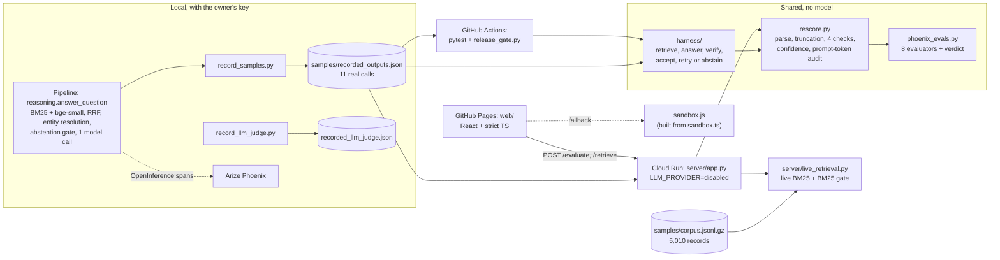

# Design: Museum QA evals

A QA pipeline over 5,010 public museum records answers with one model call per
question. Eight deterministic evaluators then decide whether to trust the
answer. They see what a reference-free judge cannot: the cited records, the
retrieved candidate set and the billed prompt tokens. Every number below was
measured or recorded; the source is named next to it.

## Components

For the 14 samples, **retrieval is replayed**: each sample carries the
candidates the real hybrid retriever returned when it was recorded, and the
answers are recorded too. The evaluators run live. A visitor's own question
gets **live BM25 only** (`POST /retrieve`): the lexical half of the
retriever and its 19.5 floor, over all 5,010 records. It gets no dense
retrieval, no fusion and no answer.

## Harness contract (`harness/`)

- **Input:** a sample, a `Retriever`, an `Answerer` and a `HarnessConfig`.
  The defaults are 3 attempts, a 10 s timeout per step, and backoff of
  0.25 s × 2ⁿ capped at 2 s.
- **Output:** a `HarnessState` with exactly one outcome:
  - `accepted`, with the attempt number that passed;
  - `abstained`, with a reason: `retrieval_gate`, `retrieval_failed`,
    `no_further_recorded_attempt` or `retry_budget_exhausted`.

  The state also holds every attempt (status, verdict, failed evaluators, all
  evaluations) and a trace of every step with its timing.
- **Gate:** an attempt is accepted only if `deterministic_verdict` is PASS.
  That verdict is the roll-up of all 8 evaluators, where INCONCLUSIVE never
  counts as a pass. No LLM judge takes part.
- **Retry:** a failed, timed-out or erroring attempt is retried until the
  budget runs out. The next attempt receives the failing evaluators'
  explanations.
- **Replay:** each sample has one recorded attempt, so a failure abstains
  with `no_further_recorded_attempt`. The public demo therefore only ever
  shows accepted or abstained; the retry path is covered by scripted tests in
  `tests/test_harness.py`.
- **Not changed:** `reasoning.answer_question` still makes one model call per
  answer.

## Failure modes

| Failure | Detection | Response | Evidence |
|---|---|---|---|
| **Evaluators and judge disagree** | Both are logged on the same span. The judge is a baseline, never the gate. | Trust the deterministic verdict. When it is wrong, it fails safe: the answer is withheld, not passed. | Rule-based stand-in judge passed 3/3 seeded false passes; the real LLM judge passed 2/3, and its one FAIL (s02) cited a reason the record contradicts. Deterministic: 3/3 FAIL. **q06** is a correct answer that the year check fails (the accession number "1947.39" read as a year), so it abstains. Kept as is, documented, not tuned away. |
| **Retrieval returns nothing usable** | The abstention gate fires before the model call when either signal is low: top BM25 below 19.5, or dense similarity below 0.35. In the harness, a retrieve step that times out or raises is caught. | Abstain with `retrieval_gate` or `retrieval_failed`, at zero tokens. | q11 (BM25 17.22) abstains. A gate of fixed thresholds lets some off-topic questions through: q10 scores 19.75, and the model declines it. |
| **Endpoint drops the system prompt** | `prompt_integrity` compares billed `prompt_tokens` with the prompt size expected with and without the instruction block. | FAIL, confidence capped to 0, not accepted. | s02 billed 3,694 tokens against 4,319 expected (midpoint 4,006). CI blocks a release if s02 stops failing or its control q03 stops passing, and a code test checks that every wire format carries the prompt. |
| **Malformed model output** | Parse errors, truncation signals (unclosed fence, no final punctuation, JSON that breaks at the end), and verifiers with nothing to check. | Never accepted. Retried while the budget allows, then abstain. | Plain prose, truncated JSON and empty output each abstain; "malformed, then valid" is accepted on attempt 2 (`tests/test_harness.py`). |

## Tradeoffs

- **Deterministic gate over an LLM judge.** It is reproducible and free, and
  it sees the evidence. The cost is false positives on real text (q06).
  Known-good therefore gates at **6/7**, not 7/7.
- **Replay over live serving.** The public service cannot spend money or leak
  a key. It has no key, no SDK and no HTTP client, and tests trip on any
  attempt. The cost is that answers exist only for 14 fixed samples. Free
  text gets live BM25 and the gate, but not dense retrieval, which would need
  torch and the embedding model in the image.
- **Concurrent evaluators.** Each one is isolated, so one that crashes
  cannot hide the others. It is not faster: on this laptop the concurrent
  verify step takes p50 1.225 ms against 0.247 ms sequential
  (`docs/data/metrics.json`).
- **The JS/TS port for the browser.** It works offline, kept honest by the
  1,040/1,040 parity test. The cost is two implementations to keep in step,
  enforced in CI.

## Limits

- **Small set.** 14 samples: 11 recorded questions, 3 seeded failures. Two of
  the seeded failures (s01, s03) are labelled edits of real answers; only s02
  is a real call. The real LLM judge was run once, on 3 samples.
- **The rate limit is per instance.** 30 requests a minute per IP in each
  instance, up to 2 instances.
- **Measured latency:**
  - **Cloud Run**, 2026-10-27, from one laptop, current revision: cold
    6,832 ms. Warm p50 is 256 ms for `/evaluate` and 362 ms for
    `/retrieve`. The first revision measured cold 4,287 ms and warm p50
    110 ms. Server compute is 0.3 ms (evaluators) and 34 ms (BM25
    search).
  - **Harness in replay**, this laptop: p50 1.263 ms, p95 1.962 ms.
  - Neither includes a model call.
- **Cost of a real call.** Recorded prompts average 4,395 tokens (range
  3,694–4,900), about 5.0K tokens per call in total.

## What I did not build

- No live *hybrid* retrieval on the public service: BM25 only, with no
  dense retrieval and no fusion. No answers to free-text questions.
- No second recorded attempts, so retry is never shown on recorded data.
- No export of harness traces to Phoenix; they are structured JSON only. The
  pipeline's own spans do go to Phoenix.
- No authentication on the API, and no rate limit shared across instances.
- No fix for the q06 year-check false positive.
- Not tested under real traffic: there is no load test, and the latency
  numbers come from one client.
